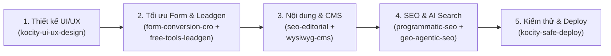

# 🧩 Bộ 8 AI Skills chuyên biệt dùng trong BTL — Dự án KOCity

> **Vị trí lưu trữ trong Repository:** [`.agents/skills/`](../.agents/skills/)  
> **Tổng số lượng:** **8 Skills chuyên môn** + **14 tài liệu tham chiếu (`references/`)** = **22 file tri thức chuẩn hóa**  
> **Mục đích:** Chuẩn hóa quy trình làm việc của AI Coding Assistants & AI Agents để đảm bảo chất lượng đồng nhất về giao diện, chuyển đổi, SEO/GEO, quản trị nội dung và triển khai an toàn cho [kocity.io.vn](https://kocity.io.vn).

---

## 1. Kiến trúc chuẩn của một AI Skill trong KOCity

Mỗi Skill trong `.agents/skills/<skill-name>/` được tổ chức theo cấu trúc mô-đun gồm 2 thành phần:
```text
.agents/skills/<ten-skill>/
├── SKILL.md                  # File định nghĩa chính: YAML frontmatter (name, description),
│                             # điều kiện kích hoạt (triggers), quy trình từng bước & luật cấm
└── references/               # Thư mục tài liệu chuyên sâu (checklist, blueprint, design tokens, SQL...)
    └── *.md / *.sql
```

**Cơ chế hoạt động:** Khi người dùng đưa yêu cầu có từ khóa khớp với `description` của Skill (ví dụ: *"tối ưu form nhận mẫu"*, *"viết bài chuẩn SEO"*, *"deploy lên kocity.io.vn"*), AI Agent **bắt buộc đọc `SKILL.md` và các file `references/` liên quan** trước khi viết code hoặc chỉnh sửa hệ thống.

---

## 2. Danh mục đầy đủ 8 AI Skills dùng trong BTL

| STT | Tên Skill | Vai trò chính | File `SKILL.md` | Tài liệu tham chiếu (`references/`) | Ứng dụng thực tế trên KOCity |
| :---: | :--- | :--- | :--- | :--- | :--- |
| **1** | **`kocity-ui-ux-design`** | Chuẩn hóa giao diện, màu tím `#7c3aed`, Mobile-First Parity, Curiosity Cloud, hiệu ứng Zalo & micro-interactions | [SKILL.md](../.agents/skills/kocity-ui-ux-design/SKILL.md) | • [brand_tokens.md](../.agents/skills/kocity-ui-ux-design/references/brand_tokens.md)<br>• [mobile_parity.md](../.agents/skills/kocity-ui-ux-design/references/mobile_parity.md)<br>• [signature_effects.md](../.agents/skills/kocity-ui-ux-design/references/signature_effects.md) | Thiết kế toàn bộ UI trang chủ, thẻ chiến dịch, Admin BI Dashboard & giao diện di động |
| **2** | **`kocity-form-conversion-cro`** | Tối ưu tỷ lệ điền form, giảm rơi rụng (drop-off) cho form đăng ký nhận mẫu 0đ (`ApplySheet`) & onboarding KOC | [SKILL.md](../.agents/skills/kocity-form-conversion-cro/SKILL.md) | • [form_cro_principles.md](../.agents/skills/kocity-form-conversion-cro/references/form_cro_principles.md) | Tối ưu luồng nộp đơn 3 bước Zero-Friction & tự điền thông tin KOC |
| **3** | **`kocity-free-tools-leadgen`** | Xây dựng công cụ miễn phí (Engineering as Marketing) & tâm lý học chuyển đổi (FOMO, khan hiếm, social proof) | [SKILL.md](../.agents/skills/kocity-free-tools-leadgen/SKILL.md) | • [viral_tools_blueprint.md](../.agents/skills/kocity-free-tools-leadgen/references/viral_tools_blueprint.md) | Phát triển trang `/cong-cu`: Tính hoa hồng TikTok, định giá kênh KOC, tạo Public Media Kit 1 chạm |
| **4** | **`kocity-geo-agentic-seo`** | Tối ưu AI Search (GEO — Google AI Overviews, ChatGPT, Perplexity, Gemini), bảo trì `llms.txt` & chống trôi SEO | [SKILL.md](../.agents/skills/kocity-geo-agentic-seo/SKILL.md) | • [citability_guidelines.md](../.agents/skills/kocity-geo-agentic-seo/references/citability_guidelines.md) | Xây dựng `public/llms.txt`, cấu trúc Citability Block & tự động kiểm tra `npm run check:seo` |
| **5** | **`kocity-programmatic-seo`** | Sinh hàng loạt landing page chiến dịch `/mau-thu/[brand]`, category hub `/koc/[niche]` & JSON-LD Rich Snippets | [SKILL.md](../.agents/skills/kocity-programmatic-seo/SKILL.md) | • [pseo_architecture.md](../.agents/skills/kocity-programmatic-seo/references/pseo_architecture.md) | Hệ thống trang đích chiến dịch động & schema Product 0đ cho từng Brand |
| **6** | **`kocity-seo-editorial`** | Quy chuẩn viết & biên tập bài viết Cẩm nang KOC, kịch bản TikTok, bí kíp nhận mẫu 0đ chuẩn SEO | [SKILL.md](../.agents/skills/kocity-seo-editorial/SKILL.md) | • [content_frameworks.md](../.agents/skills/kocity-seo-editorial/references/content_frameworks.md)<br>• [seo_checklist.md](../.agents/skills/kocity-seo-editorial/references/seo_checklist.md) | Biên soạn bộ bài viết trong `src/data/blogData.ts` & bài công bố 68 KOC Cỏ Mềm |
| **7** | **`kocity-wysiwyg-cms`** | Phát triển & bảo vệ Admin CMS, trình soạn thảo bài viết giàu định dạng (WYSIWYG), chống lỗi thẻ `<span>` / mất định dạng | [SKILL.md](../.agents/skills/kocity-wysiwyg-cms/SKILL.md) | • [editor_principles.md](../.agents/skills/kocity-wysiwyg-cms/references/editor_principles.md)<br>• [wysiwyg_standards.md](../.agents/skills/kocity-wysiwyg-cms/references/wysiwyg_standards.md) | Quản trị bài viết trên `AdminBlogManager.tsx` & hiển thị an toàn tại `BlogContentRenderer.tsx` |
| **8** | **`kocity-safe-deploy`** | Quy trình triển khai an toàn Zero-Regression lên `kocity.io.vn`: kiểm tra TypeScript, SEO, build sạch & bảo mật Supabase | [SKILL.md](../.agents/skills/kocity-safe-deploy/SKILL.md) | • [deploy_checklist.md](../.agents/skills/kocity-safe-deploy/references/deploy_checklist.md)<br>• [regression_safeguards.md](../.agents/skills/kocity-safe-deploy/references/regression_safeguards.md)<br>• [supabase_security_setup.sql](../.agents/skills/kocity-safe-deploy/references/supabase_security_setup.sql) | Áp dụng bắt buộc trước mọi lần commit & push lên GitHub / Vercel production |

---

## 3. Quy trình phối hợp liên-Skill (Skill Chaining) trong phát triển thực tế

Trong BTL, các Skill không đứng độc lập mà phối hợp theo chuỗi công việc chuẩn hóa:



### Ví dụ chuỗi phối hợp thực tế cho Chiến dịch Cỏ Mềm Homelab (68 KOC):
1. **`kocity-seo-editorial` + `kocity-wysiwyg-cms`:** Xuất bản bài công bố 68 KOC nhận mẫu 0đ Cỏ Mềm kèm thanh tìm kiếm realtime và bảng sản phẩm.
2. **`kocity-ui-ux-design`:** Chuẩn hóa giao diện bảng danh sách, nút bấm nhận mẫu và Dashboard Admin BI theo dõi 3 đợt chiến dịch Cỏ Mềm.
3. **`kocity-form-conversion-cro`:** Gắn cơ chế click beacon `fetch keepalive` tại `BlogContentRenderer.tsx` → kết nối n8n Cloud & Telegram báo cáo tức thời khi KOC bấm nhận mẫu.
4. **`kocity-safe-deploy`:** Chạy kiểm tra `npm run check:seo`, `npm run build` (0 lỗi), xác minh không rò rỉ token bí mật trước khi push lên nhánh `main` deploy tự động lên `kocity.io.vn`.

---

## 4. Hướng dẫn kiểm tra & sử dụng lại Bộ Skills

1. Toàn bộ 8 thư mục Skill đã được commit đầy đủ tại [`.agents/skills/`](../.agents/skills/).
2. Khi mở repository bằng **Antigravity** hoặc **Claude Code**, hệ thống tự động nhận diện thư mục `.agents/skills/` và nạp ngữ cảnh từ [CLAUDE.md](../CLAUDE.md).
3. Để kích hoạt trực tiếp một Skill bất kỳ, chỉ cần gọi đúng tên hoặc chủ đề trong câu lệnh, ví dụ:
   - *"Sử dụng skill `kocity-safe-deploy` để kiểm tra build và đẩy bản cập nhật lên `kocity.io.vn`."*
   - *"Áp dụng `kocity-geo-agentic-seo` để rà soát `public/llms.txt` và Citability Block cho bài blog mới."*
